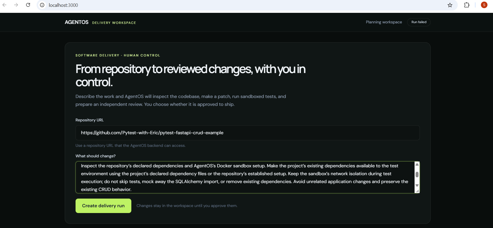
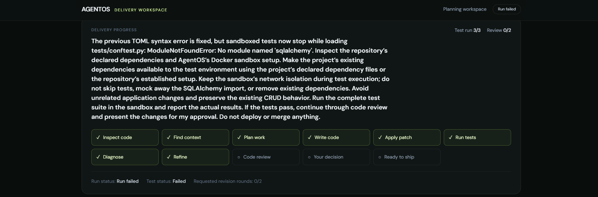
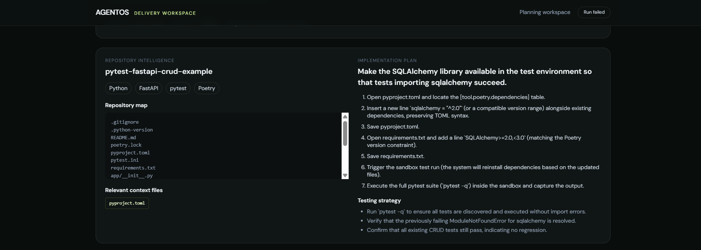
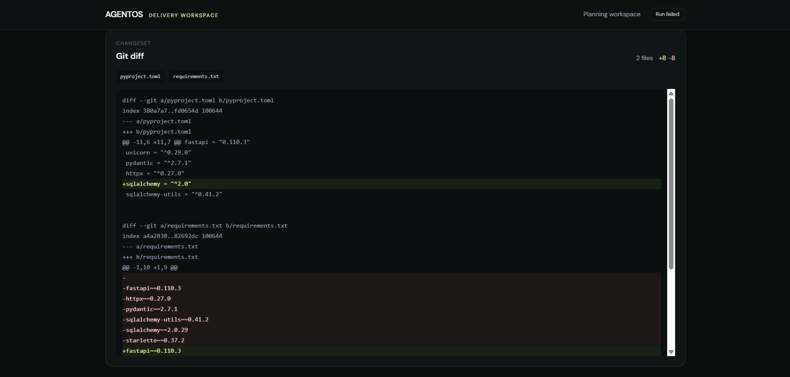
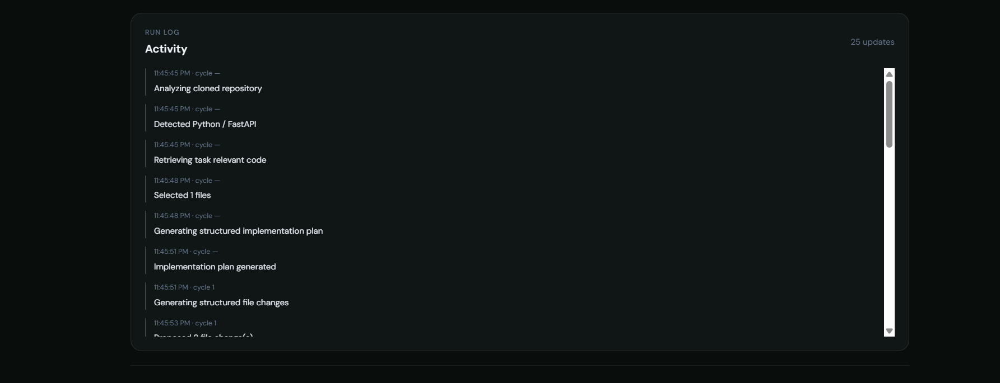

# AgentOS

**Autonomous Software Delivery Control Plane**

## What it does

AI agents can write code, but reliable delivery also needs repository context, a plan, isolated tests, debugging, review, and human approval. AgentOS connects those steps into one observable workflow and leaves the final ship decision to a person.

```text
User task → Repository intelligence → Plan → Code → Docker tests
          → Debug and retry → AI review → Human approval → Ready to ship
```

## Screenshots

### 1. Task Input — Describe what should change
Paste a public repository URL and describe the task in plain language. AgentOS handles the rest.



### 2. Repository Intelligence + Implementation Plan
AgentOS analyzes the repository structure, selects relevant context files, and generates a structured step-by-step implementation plan before touching any code.



---

### 3. Delivery Progress — Live pipeline view
Watch the agent move through each stage: inspect code, find context, plan, write code, apply patch, run tests, diagnose, refine, code review, and await your decision.



---

### 4. Run Log — Full activity timeline
Every action the agent takes is logged with timestamps so you have a complete audit trail of what happened and when.



---

### 5. Changeset — Git diff for human review
Before anything ships, you review the exact git diff. Changes stay in the workspace until you explicitly approve them.



---

## Run locally

Requirements: Python 3.11+, Node.js 20+, Git, Docker Desktop with its Linux engine, and a Groq API key.

1. In PowerShell at the repository root, run `Copy-Item .env.example .env` and set `GROQ_API_KEY` in `.env`. Keep the key private; it stays on the backend.
2. Install backend packages: `python -m pip install -r backend/requirements.txt`.
3. Start the API: `python -m uvicorn backend.main:app --reload --port 8000`.
4. In a second terminal: `cd frontend`, `npm install`, then `npm run dev`.
5. Open http://localhost:3000. API documentation: http://localhost:8000/docs.

The variables in `.env.example` cover the provider key/model, frontend API URL, and workspace directory. Restart the API after changing `.env`.

## Demo

Use the public repository `https://github.com/octocat/Hello-World` and ask: **"Add a small stdlib-only Python WSGI app with a GET /health endpoint returning `{status: ok}`. Add pytest tests for success and a 404. Do not add dependencies."** AgentOS analyzes the repository, plans, creates the app and tests, runs the real tests in Docker, reviews the diff, and waits for human approval. A test failure, if one occurs, is handled by the debugger and bounded retry loop; failures are never fabricated. See [docs/DEMO.md](docs/DEMO.md) for the presenter script.

## Stack and safety

Next.js, TypeScript, Tailwind CSS, FastAPI, Python, LangGraph, Groq, Git, Docker, and pytest. File changes are confined to validated repository-relative paths. Tests run in a network-disabled container with resource limits and a sanitized workspace. Tests count as passed only after a zero exit code. A reviewer-approved change remains `WAITING_FOR_HUMAN_APPROVAL` until a human approves it; `READY_TO_SHIP` does not deploy or merge anything.

Run records are held in memory and clear when the API restarts. Clones remain under ignored `workspaces/`. The sandbox does not install arbitrary project dependencies.

## Checks

- Backend: `python -m pytest -q`
- Frontend production build: from `frontend`, `npm run build`

## Roadmap

Future possibilities: persistent engineering memory, PostgreSQL/Supabase, GitHub PR automation, advanced repository indexing, multi-agent collaboration, and production deployment integrations.
